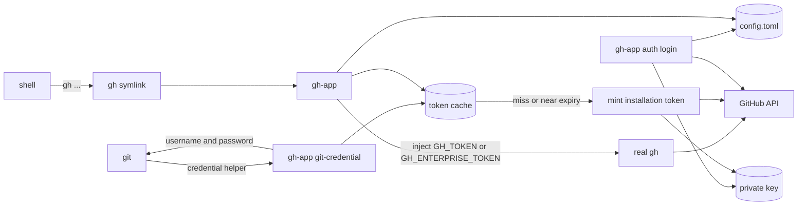

# gh-app design

Status: proposed, pre-implementation
Date: 2026-11-02

## 1. Summary

`gh-app` is a single Rust binary that lets the GitHub CLI (`gh`) and `git` use
GitHub App installation credentials instead of a personal access token or an
OAuth login.

It does three things:

1. Captures and stores the GitHub App identity (host, app ID, installation ID,
   private key) through `gh-app auth login`.
2. Mints short-lived installation access tokens on demand and caches them until
   shortly before expiry.
3. Acts as a multi-call binary:
   - installed as `gh` (symlink), it injects the token and executes the real gh
   - installed as `gh-app`, it provides management commands
   - used as `gh-app git-credential`, it implements the git credential helper

No daemon or background service is required. The credential cache makes the
common case one small file read plus a process exec.

### Recommendation at a glance

| question | recommendation |
|---|---|
| Where does config live? | `$XDG_CONFIG_HOME/gh-app` or `~/.config/gh-app` on Unix, `%APPDATA%\gh-app` on Windows |
| Where do tokens live? | `$XDG_CACHE_HOME/gh-app` or `~/.cache/gh-app`, 0600, deleted on logout |
| Where does the private key live? | `~/.config/gh-app/keys/<host>-<app_id>.pem`, 0600, or the OS keyring with `--keyring` |
| How is gh shadowed? | `gh` symlink to `gh-app` in a PATH directory, plus an absolute git helper path |
| How does git authenticate? | `gh-app git-credential`, configured with a blank reset plus the helper for each host |
| Is a daemon needed? | No for v1, a short-lived token cache is enough |

## 2. Goals and non-goals

Goals:

- Full shadowing of `gh` for normal PATH lookups, with identical behavior for
  all commands except the auth commands that must be managed by the wrapper.
- `git` HTTPS operations authenticated with an installation token.
- GitHub.com, GitHub Enterprise Cloud with data residency (`*.ghe.com`), and
  GitHub Enterprise Server support.
- Secure local storage of a long-lived private key.
- Static Linux binaries for x86_64 and aarch64.
- Clear failure modes and no silent fallback to a stale PAT.

Non-goals for v1:

- Acting as a human user. Installation tokens are bot identities.
- GitHub App user-to-server OAuth tokens or device flow.
- Gists, Codespaces, Copilot, or other user-only features.
- SSH credential management.
- Revoking private keys on GitHub.
- Multi-user or system-wide installation.
- A long-running token broker daemon.
- Managing more than one app installation per host.

## 3. Architecture



Data flow:

- `gh-app auth login` validates the app, installation, key, and a real token
  mint before writing anything.
- Every `gh` invocation resolves the target host, reads or mints a token for
  that host, sets the correct gh environment variable, and `exec`s the real gh.
- Git invokes the credential helper, which returns `x-access-token` plus the
  installation token. The token is marked ephemeral when git supports it.
- The private key is only read on a cache miss or refresh, at most about once
  per hour per host.

## 4. Command surface

```text
gh-app auth login [flags]
gh-app auth status [--hostname HOST] [--json] [--verify]
gh-app auth token [--hostname HOST] [--refresh]
gh-app auth refresh [--hostname HOST]
gh-app auth logout [--hostname HOST | --all] [--yes] [--keep-git-config]
gh-app auth setup-git [--hostname HOST] [--force]
gh-app auth list
gh-app setup [--shim-dir DIR] [--force] [--no-shim] [--no-git]
gh-app doctor [--offline] [--json]
gh-app version
gh-app git-credential get|store|erase
gh-app gh <args...>            # explicit passthrough
gh-app auth git-credential ... # hidden compatibility alias
```

### 4.1 auth login

Interactive by default, fully scriptable with flags or environment variables.

```text
gh-app auth login \
  --hostname github.com \
  --app-id 123456 \
  --installation-id 987654 \
  --private-key ~/Downloads/my-app.private-key.pem
```

Flags:

- `--hostname HOST`: GitHub host. Default is inferred from the current git
  remote, then `github.com`.
- `--app-id ID`: required unless `GH_APP_APP_ID` is set or a previous config
  supplies a default.
- `--installation-id ID`: optional. If omitted, `gh-app` lists the app's
  installations with the JWT and prompts. In non-interactive mode it must be
  provided if there is more than one.
- `--private-key PATH|-`: PEM file, or `-` to read from stdin. If omitted,
  prompt for a path, with a default of the managed key path if it exists.
- `--keyring`: store the key in the OS keyring instead of a file.
- `--reference-key`: do not copy the key into the managed config directory.
- `--client-id ID`: optional JWT issuer override.
- `--api-url URL`: optional API base override, mainly for tests and unusual
  enterprise setups.
- `--cacert PATH`: additional PEM CA bundle for enterprise TLS.
- `--no-verify`: parse and store without calling GitHub. Not recommended.
- `--force`: overwrite an existing host entry.

Environment fallbacks for automation:

- `GH_APP_APP_ID`
- `GH_APP_INSTALLATION_ID`
- `GH_APP_PRIVATE_KEY` (PEM contents)
- `GH_APP_PRIVATE_KEY_PATH` (file path)
- `GH_APP_HOST`
- `GH_APP_API_URL`
- `GH_APP_CA_BUNDLE`

Validation sequence:

1. Normalize the host and resolve the API base URL.
2. Read the key with permission checks, parse PKCS#1 or PKCS#8, require 2048 to
   4096 bits (the range ring can sign with), and compute the public-key SHA-256
   fingerprint.
3. Sign a JWT and call `GET /app`. This verifies the app ID and key and yields
   the app slug, name, owner, and client ID.
4. Resolve the installation, then call `GET /app/installations/{id}`. Verify
   that the installation belongs to the app and is not suspended.
5. Mint a token, then call `GET /installation/repositories?per_page=1` to verify
   repository access and capture the total repository count.
6. Copy the key into the managed key path with mode 0600 unless keyring or
   `--reference-key` was selected.
7. Write `config.toml` atomically.

On failure, no partial config is left behind and a copied key is removed.

The login output shows:

- app slug, app ID, client ID, owner
- installation ID, account login and type
- repository selection and repository count
- granted permissions, with warnings when `contents` is absent or read-only
- key fingerprint, so it can be compared with the GitHub app settings page

### 4.2 auth status

Shows one section per configured host:

```text
github.com
  App:          my-automation (id 123456, client Iv1.abc)
  Installation: 987654 (acme-org, organization)
  Repositories: all
  Permissions:  contents:write, pull_requests:write, metadata:read
  Token:        ghs_****** expires in 43m
  Key:          ~/.config/gh-app/keys/github.com-123456.pem (0600, sha256:...)
  Git helper:   configured (!/usr/local/bin/gh-app git-credential)
  gh shim:      active (/home/u/.local/bin/gh -> /usr/local/bin/gh-app)
  Real gh:      /usr/bin/gh (2.102.0)
```

`--json` provides a stable machine-readable schema. `--verify` forces a token
mint and API validation. Without `--verify`, a valid cached token is used and no
network call is needed. Exit code is 1 if a host is configured but invalid.

### 4.3 Other commands

- `auth token`: prints only the token, minting or refreshing if needed. This is
  the scripting equivalent of `gh auth token`.
- `auth refresh`: deletes the cached token, mints a new one, validates it, and
  prints the new expiry.
- `auth logout`: removes the host config, managed key file, cached token, and
  git helper entries. It does not revoke the key on GitHub. It asks for
  confirmation unless `--yes`.
- `auth list`: compact host table.
- `auth setup-git`: rewrites git credential helper configuration for one host
  or all configured hosts.
- `setup`: installs the `gh` shim, runs `auth setup-git`, and prints verification
  steps. It never edits shell startup files automatically.
- `doctor`: checks config, key permissions, JWT signing, API reachability,
  installation match, token mint, git helper config, shim PATH order, real gh
  discovery, gh `git_protocol`, and environment token conflicts. `--offline`
  skips network checks.

## 5. Shadowing gh

### 5.1 Installation

`gh-app setup` creates a symlink `gh -> gh-app` in a shim directory, default
`~/.local/bin`. It refuses to overwrite a real file unless `--force` is given.

It then checks whether the shim directory precedes the real gh in `PATH`. If it
does not, it prints an exact shell snippet and exits non-zero. It does not edit
`.bashrc`, `.zshrc`, or profile files.

After installation, `hash -r` may be needed in the current shell.

`argv[0]` dispatch:

| basename | behavior |
|---|---|
| `gh` | passthrough mode |
| `gh-app` | management CLI |
| `git-credential-gh-app` | git credential helper |
| anything else | management CLI |

This dispatch was validated with a static 417 KiB Rust prototype and real
symlinks for `gh`, `gh-app`, and `git-credential-gh-app`.

The real gh is discovered by:

1. `GH_APP_REAL_GH`, if set.
2. The `real_gh` path saved by `setup`, if it still exists and is executable.
3. A PATH scan that skips the shim directory and any candidate that is the same
   file as the running binary.

The resolved real gh is verified to look like gh. If it is the shim itself, the
wrapper errors instead of recursing. `gh-app doctor` reports the resolved path
and version.

### 5.2 Intercepted auth commands

| invocation | behavior |
|---|---|
| `gh auth login` | redirect to `gh-app auth login`, mapping `--hostname` |
| `gh auth logout` | redirect to `gh-app auth logout` |
| `gh auth refresh` | redirect to `gh-app auth refresh` |
| `gh auth setup-git` | redirect to `gh-app auth setup-git` |
| `gh auth switch` | error, one app credential per host in v1 |
| `gh auth status` | pass through with the app token injected |
| `gh auth token` | pass through with the app token injected |
| `gh auth` | pass through to gh help |
| everything else | pass through |

`gh auth status` and `gh auth token` are deliberately passed through so their
output and JSON schema remain exactly gh-compatible. gh will show the token
source as `GH_TOKEN` or `GH_ENTERPRISE_TOKEN` and the account as the app bot.

Unsupported flags on intercepted login, such as `--web`, `--with-token`, or
`--scopes`, produce an error that points at `gh-app auth login --help` instead
of being silently ignored.

### 5.3 Passthrough token injection

For commands that are not intercepted:

1. Static commands (`--version`, `version`, `help`, `--help`, `completion`,
   `__complete`, `__completeNoDesc`) execute without a token.
2. Resolve the target host:
   - `GH_APP_HOST`, if set
   - `--hostname` in the gh arguments
   - a host prefix in `--repo`/`-R` or `GH_REPO`
   - `GH_HOST`
   - the current git remote, for repository-scoped commands
   - `settings.default_host`
3. If no gh-app credential exists for that host, execute gh unchanged. With
   `GH_APP_STRICT=1`, error instead.
4. If an explicit `GH_TOKEN`/`GH_ENTERPRISE_TOKEN` is already set and
   `GH_APP_FORCE=1` is not set, respect the explicit token and execute unchanged.
5. Otherwise read or mint a token and set:
   - `GH_TOKEN` for `github.com` and `*.ghe.com`
   - `GH_ENTERPRISE_TOKEN` for GitHub Enterprise Server
6. Execute the real gh. On Unix use `execvp` so signals, TTY, file descriptors,
   and exit status are preserved. On Windows spawn and forward the exit code.
7. If minting fails, do not execute gh by default. Otherwise gh could silently
   fall back to a stored PAT. `GH_APP_FALLBACK=1` opts into that fallback.

`GH_HOST` is never set or removed by the wrapper. The user's host selection
behavior is preserved.

When both a cloud host and a GHES host are configured, both environment
variables can be set, because gh selects between them by target host. If two
configured hosts share the same variable (for example `github.com` and
`acme.ghe.com` both use `GH_TOKEN`) and the target host cannot be inferred, the
wrapper uses `settings.default_host` or requires `GH_APP_HOST`. This is a gh
environment limitation, not a wrapper design choice.

## 6. Storage

### 6.1 Locations

| data | Unix | Windows | override |
|---|---|---|---|
| config and keys | `$XDG_CONFIG_HOME/gh-app` or `~/.config/gh-app` | `%APPDATA%\gh-app` | `GH_APP_CONFIG_DIR` |
| token cache | `$XDG_CACHE_HOME/gh-app` or `~/.cache/gh-app` | `%LOCALAPPDATA%\gh-app\cache` | `GH_APP_CACHE_DIR` |

Using `~/.config/gh-app` on macOS matches what gh itself does and keeps one
documented path across Unix. Windows uses the platform config directory.

Directory layout:

```text
~/.config/gh-app/
  config.toml                         0600, no secrets
  keys/
    github.com-123456.pem             0600, default key storage
  README.txt                          optional short recovery notes

~/.cache/gh-app/
  tokens/
    5f2c...c9.json                    0600, short-lived token
    5f2c...c9.lock                    0600, mint lock
```

If the OS keyring is used, the `keys/` file is absent and config points at the
keyring entry.

### 6.2 config.toml

```toml
version = 1

[settings]
default_host = "github.com"
refresh_skew_seconds = 300
cache_tokens = true

[hosts."github.com"]
app_id = 123456
installation_id = 987654
client_id = "Iv1.0123456789abcdef"      # learned at login if available
app_slug = "my-automation"              # display only
account_login = "acme-org"              # display only
private_key = "keys/github.com-123456.pem"

# Exactly one of these is used:
# private_key = "keys/github.com-123456.pem"
# private_key_keyring = "gh-app/github.com/123456"
# private_key_env = "GH_APP_PRIVATE_KEY"
# private_key_command = ["op", "read", "op://Private/gh-app/key"]   # future

# Optional per-token downscoping. Leave unset for the installation's full grant.
# repositories = ["acme/api", "acme/web"]
# permissions = { contents = "read", pull_requests = "write" }

# Optional API override. Normally derived from the host.
# api_url = "https://api.github.com"
```

Rules:

- `config.toml` is mode 0600. It contains no private key and no token, but app
  and installation IDs are still treated as sensitive metadata.
- Unknown fields are tolerated and preserved on rewrite where practical, so a
  newer binary can add fields without breaking older ones.
- `version` greater than the supported version is a hard error.
- Relative `private_key` paths resolve against the config directory. Absolute
  paths and `~` are allowed.
- `private_key`, `private_key_keyring`, `private_key_env`, and
  `private_key_command` are mutually exclusive.

### 6.3 Token cache

One JSON file per host, app, installation, and downscope:

```json
{
  "version": 1,
  "host": "github.com",
  "app_id": 123456,
  "installation_id": 987654,
  "scope_hash": "sha256:...",
  "token": "ghs_...",
  "expires_at": "2026-11-02T14:00:00Z",
  "minted_at": "2026-11-02T13:00:00Z",
  "permissions": { "contents": "write", "metadata": "read" },
  "repository_selection": "all"
}
```

Behavior:

- Read if `now < expires_at - refresh_skew_seconds` (default 300 seconds).
- On a miss or near-expiry, take an exclusive lock, re-read, mint if still
  needed, write atomically, release the lock.
- Use a hash of the identity and scope as the file name, never raw host text.
- Cache corruption is treated as a miss and overwritten.
- `cache_tokens = false` or `GH_APP_NO_CACHE=1` disables disk caching. Every
  invocation then mints a token. This is slower and increases token creation
  requests, but avoids a bearer token on disk.
- Logout deletes the cache entry for the host.

The lock plus atomic-write path was validated with eight concurrent processes:
the final counter was 8 and both the cache and lock files were mode 0600. Rust
1.99's standard `File::lock` was sufficient, so `fs4` is not needed.

The cache contains a bearer token, not the private key. A stolen cache file
grants access only until the token expires, at most one hour. It is still mode
0600.

### 6.4 Why not store the key in config.toml

The private key is a long-lived, high-value secret. Keeping it as a separate
PEM file with its own permission checks makes the security boundary explicit,
allows keyring storage, avoids accidental config dumps, and makes rotation a
file replacement. Embedding key material in TOML also makes it easy to leak in
backups, logs, or bug reports.

### 6.5 Private key storage options

Recommended default: file at
`~/.config/gh-app/keys/<host>-<app_id>.pem`, owned by the user, mode 0600,
directory mode 0700, created without following symlinks. This is the same
practical security level as an SSH private key and relies on full-disk
encryption for at-rest protection.

Better on desktops: `gh-app auth login --keyring` stores the PEM in the OS
secret store:

- macOS Keychain
- Windows Credential Manager
- Linux Secret Service (GNOME Keyring, KWallet) via the `keyring` crate

Headless Linux usually has no Secret Service, so file storage remains the
fallback. If the keyring is unavailable, `--keyring` fails with a clear message
instead of silently falling back to a file.

The `keyring` 4.2 dependency compiled into a static x86_64 musl binary (4.6 MiB
total). On a headless host, `Entry::new` returned `NoDefaultStore`, as expected.
The binary size and runtime behavior confirm that keyring support should remain
optional and that file storage must be the default.

For CI and ephemeral environments: `GH_APP_PRIVATE_KEY` or `--private-key -`
keeps the key out of the config directory and out of argv. The key still exists
in the process environment or stdin, so this is only appropriate for isolated
runners.

Future: `private_key_command` can fetch the key from 1Password, Vault, or a
cloud secret manager. A signer abstraction allows a future KMS or HSM backend
that signs the JWT without exporting the key.

Passphrase-encrypted PEM is not a v1 default. Every `gh` invocation would need
the passphrase to refresh the token, which breaks the seamless shim. A daemon or
agent would be required to unlock once. Keyring or a command-based signer is a
better fit.

## 7. Token lifecycle

### 7.1 JWT

- Header: `{"alg":"RS256","typ":"JWT"}`
- Claims: `iat = now - 60`, `exp = now + 540`, `iss = client_id or app_id`
- Base64url without padding
- Signature: RSASSA-PKCS1-v1_5 with SHA-256, implemented with `ring`

If the token endpoint rejects the JWT with a clock-related 401, the wrapper
reads the server `Date` header, computes the skew, retries once with adjusted
claims, and prints a warning recommending NTP. Skew is not persisted.

### 7.2 Mint

```http
POST /app/installations/{installation_id}/access_tokens
Authorization: Bearer <JWT>
Accept: application/vnd.github+json
X-GitHub-Api-Version: 2026-03-10
User-Agent: gh-app/<version>
```

Optional body for downscoping:

```json
{
  "repositories": ["acme/api"],
  "permissions": { "contents": "read" }
}
```

Response fields used: `token`, `expires_at`, `permissions`,
`repository_selection`, `repositories`.

The token is never parsed or length-checked. GitHub is rolling out a stateless
`ghs_APPID_JWT` format, so only emptiness is validated.

### 7.3 Refresh and failure

- Refresh at `expires_at - 300s`.
- On HTTP 401 from the mint endpoint, invalidate the cached token, re-sign a
  fresh JWT, and retry once.
- On 403/404/422, do not retry. Report the GitHub message, status, request ID,
  and rate-limit reset when present.
- On 429 or 5xx, retry at most twice with backoff, honoring `Retry-After`.
- Long-running gh commands can outlive the one-hour token. The wrapper mints
  immediately before exec, which maximizes usable time, but it cannot rotate an
  environment variable inside an already running gh process. This is documented
  as a limitation. A daemon or local broker would be needed to solve it.

## 8. Git credential helper

### 8.1 Protocol

`gh-app git-credential get` reads the standard input format, including `url=`
and `capability[]=authtype`, and writes a credential to stdout.

Git's HTTP transport advertises `capability[]=authtype` (verified with git
2.47.3 against a real 401 response). `git credential fill` does not. The helper
must branch on the capability: if it emits the authtype form when the caller did
not offer the capability, Git silently drops the credential and keeps no
password. This is a required behavior, not an optimization.

For a configured host:

```text
protocol=https
host=github.com
username=x-access-token
password=<installation token>
password_expiry_utc=<epoch seconds>
```

When the caller advertised `capability[]=authtype` (git 2.46 and newer), the
helper responds with the opaque form and marks the credential ephemeral:

```text
capability[]=authtype
protocol=https
host=github.com
username=x-access-token
authtype=Basic
credential=<base64(x-access-token:TOKEN)>
ephemeral=1
```

`ephemeral=1` prevents caching helpers such as `git-credential-cache` from
serving a stale installation token.

`store` and `erase` are no-ops and exit 0. Git must not be able to persist or
delete the app credential through the helper.

Unknown hosts produce no output and exit 0, allowing other helpers to answer.
A configured host that fails to mint prints a sanitized error to stderr and
exits 1. The token is never printed to stderr.

The helper must echo the `host` value exactly as Git sent it, including a
non-default port. Configured hosts are matched after normalizing the default
port, but the response keeps the original value.

Git can call the helper more than once for the same authentication attempt and
may include its own `authtype`, `credential`, `ephemeral`, and `wwwauth[]`
fields on a later call. Treat every invocation as a fresh request, ignore
unknown fields, and do not echo a credential supplied by the caller.

Only `protocol=https` is accepted in v1. A test-only `GH_APP_ALLOW_HTTP=1`
escape hatch can allow HTTP for local mock servers.

### 8.2 Git configuration

For each host, `gh-app auth setup-git` runs the equivalent of:

```text
git config --global --replace-all credential.https://github.com.helper ""
git config --global --add credential.https://github.com.helper '!/usr/local/bin/gh-app git-credential'
```

The blank first value severs any inherited helper chain for that host, matching
what gh does. This is important because an inherited `store`, `cache`, or
`manager` helper could otherwise answer first with a stale PAT.

The helper path is absolute. A later PATH change must not break git.

The gist host is not configured by default. GitHub Apps cannot access gists, so
configuring `gist.github.com` would only produce failures. If an old gh gist
helper remains, it is left alone, and doctor reports it.

gh itself configures a gist helper for `*.ghe.com` hosts, while gh-app
intentionally does not. This is a deliberate compatibility difference, because
installation tokens cannot access gists. For GHES, gh does not configure a gist
helper either, so the behavior matches.

On logout, the two helper entries for the host are removed unless
`--keep-git-config` is used.

On Windows, the command is quoted with single quotes for the POSIX shell git
uses, for example `!'C:\Program Files\gh-app\gh-app.exe' git-credential`.

## 9. Host handling

| host pattern | API base | environment variable |
|---|---|---|
| `github.com` | `https://api.github.com` | `GH_TOKEN` |
| `*.ghe.com` | `https://api.<host>` | `GH_TOKEN` |
| GitHub Enterprise Server | `https://<host>/api/v3` | `GH_ENTERPRISE_TOKEN` |
| `github.localhost` | `http://api.github.localhost` | `GH_ENTERPRISE_TOKEN` for tests |
| override | `api_url` in config | by host class |

Hostnames are lowercased, trimmed, and rejected if they contain a scheme, path,
or port, matching gh's hostname validator. Punycode/IDN hosts are out of scope.

The `X-GitHub-Api-Version` header is sent for GitHub Cloud hosts and omitted for
GHES, where API versioning differs.

TLS uses the bundled webpki roots plus an optional `--cacert` or
`GH_APP_CA_BUNDLE` bundle. Corporate TLS inspection proxies therefore work
without disabling verification. `HTTPS_PROXY`, `HTTP_PROXY`, and `NO_PROXY` are
honored through ureq's proxy support.

## 10. Security model

### 10.1 Assets

| asset | lifetime | impact if leaked |
|---|---|---|
| private key | until revoked | persistent app authentication, can mint tokens for every installation |
| config | persistent | app and installation IDs, not enough to authenticate alone |
| token cache | up to 1 hour | installation access within granted permissions |
| token in process environment | life of gh process | same as token cache |
| token in git credential cache | helper-dependent | stale or valid token until expiry |

### 10.2 Controls

- Config directory 0700, config file 0600, key file 0600, cache file 0600.
- Key file opened with `O_NOFOLLOW` on Unix. Symlinked keys are refused by
  default.
- Key file must be owned by the current user. Group or other read/write bits are
  refused. `GH_APP_ALLOW_INSECURE_KEY=1` is an explicit escape hatch.
- Parent directories must not be world-writable.
- Atomic writes through a same-directory temporary file, mode 0600, then rename.
- Private key bytes, PKCS#8 DER, JWTs, and token buffers are zeroized on drop.
- Secrets are never accepted as command-line arguments. Keys can be read from
  stdin. Tokens are only printed by explicit `auth token` or `--show-token`
  commands.
- Error messages and debug logs redact authorization headers and token values.
  Tokens are displayed only as `ghs_******`.
- The helper marks tokens ephemeral so git caching helpers do not persist them.
- The cache is optional and short lived.
- No telemetry. The only network destination is the configured GitHub API.
- `umask(077)` is set at startup on Unix.
- Core dumps are disabled where practical while key material is in memory.

The key-file boundary was validated with a static prototype on x86_64 and
aarch64: mode 0600 was accepted, 0644 was rejected, a symlink was rejected with
`ELOOP`, and a world-writable parent directory was rejected.

### 10.3 Residual risks

- Malware running as the same user can read the key file or ptrace the process.
  Keyring storage and a future sign-only backend reduce but do not eliminate
  this.
- The token is passed to gh in an environment variable. On Linux, same-user
  processes and root can read `/proc/<pid>/environ`. The alternative, writing it
  into gh's config, is persistent and worse.
- Backups may include the config directory. Users should exclude it or use the
  keyring.
- A user with root can read everything. Full-disk encryption protects data at
  rest only.
- A stolen private key remains valid until revoked on GitHub. Logout does not
  and cannot revoke it.

### 10.4 Why not write a token into gh's hosts.yml

gh has no supported mechanism for a token command or dynamic credential
provider. Writing a token into `~/.config/gh/hosts.yml` would persist a
credential that expires in an hour, require a background refresher to keep it
fresh, and mutate gh's own state. Injecting `GH_TOKEN` for the lifetime of one
process is simpler and leaves no persistent token beyond the short-lived cache.

## 11. Compatibility and limitations

Expected to work, subject to app permissions:

- repository clone, fetch, pull, push over HTTPS
- pull requests, issues, releases, actions, checks, statuses
- `gh api` for endpoints that accept installation tokens
- gh extensions that use the injected environment token
- `gh auth status` and `gh auth token`, showing the app bot

Known limitations:

- `gh auth login` and `gh auth logout` are intercepted by design.
- `gh auth switch` is unsupported in v1.
- `gh gist`, `gh codespace`, `gh copilot`, `gh ssh-key`, and `gh gpg-key` are
  user-only or unsupported for app installations.
- `gh api user` fails. Use `gh api installation` or `gh auth status`.
- `--author @me`, `--assignee @me`, and similar human-identity flags may fail or
  resolve to the bot.
- Repositories and forks cannot be created under a personal account.
- Some REST endpoints explicitly reject installation tokens.
- `gh repo clone` uses gh's `git_protocol` setting. If it is `ssh`, the clone
  bypasses the credential helper. Doctor warns about this, and users can run
  `gh config set git_protocol https`.
- A gh command that runs longer than the token lifetime may fail after expiry.
- If an explicit `GH_TOKEN` is present, it wins unless `GH_APP_FORCE=1`.
- Direct execution of the absolute real gh path bypasses the shim.
- `sudo` and GUI launchers may have a different PATH and may not see the shim.

## 12. Error handling

| condition | behavior |
|---|---|
| no config for host | pass through to gh or git helper returns nothing |
| config exists, key missing | exit 1 with the expected path and `gh-app auth login` hint |
| key permissions too open | refuse, show `chmod 600` command |
| JWT 401 | retry once for clock skew, then explain app ID/key mismatch |
| installation 404 | app not installed on the account, or wrong installation ID |
| 403 | show GitHub message, app permissions, and rate-limit reset |
| 422 on token mint | show invalid downscope repository or permission |
| network timeout | exit 1, suggest checking proxy and `GH_APP_CA_BUNDLE` |
| cache lock timeout | exit 1, suggest removing the stale lock after checking processes |
| token near expiry | refresh before use |
| gh not found | error with `GH_APP_REAL_GH` and install instructions |

Exit codes: 0 success, 1 operational failure, 2 usage error. Passthrough
preserves gh's exit code.

## 13. Rust implementation

### 13.1 Crates

- `clap` 4 with derive, `clap_complete` for shell completions
- `serde`, `serde_json`, `toml`
- `ureq` 3 with rustls/ring, json, gzip, proxy support
- `ring` 0.17 for RS256 signing
- `rsa` 0.9 for PEM parsing and public-key fingerprint only, not signing
- `base64`, `sha2`, `time`
- `thiserror`
- `dirs` or `directories` for platform paths
- `tempfile` for atomic writes; `std::fs::File::lock` for cache locking
- `secrecy`, `zeroize`
- `keyring` 4, optional feature, for OS keyring storage
- `rustix` or `libc` for Unix permission, umask, and `O_NOFOLLOW`
- dev: `assert_cmd`, `predicates`, `httpmock`, `tempfile`

`jsonwebtoken` is intentionally not used. The JWT is 30 lines of
base64url plus `ring`, and avoiding it keeps the crypto path auditable and avoids
pulling a second crypto provider.

### 13.2 Modules

```text
src/main.rs                 argv[0] dispatch
src/cli.rs                  clap definitions
src/error.rs                domain errors and redaction
src/paths.rs                XDG and platform paths
src/config/                 schema, load, save, permission checks
src/key.rs                  file, env, keyring key sources
src/signer.rs               Signer trait, RS256 with ring
src/jwt.rs                  JWT encoding
src/github/                 host mapping, API client, response types
src/token.rs                cache, locking, minting, refresh
src/gh/                     real gh discovery, target host, exec
src/git_credential.rs       protocol parsing and output
src/commands/               auth, setup, doctor, version
src/term.rs                 prompts, color, TTY detection
```

### 13.3 Key types

```rust
trait Signer {
    fn sign(&self, message: &[u8]) -> Result<Vec<u8>>;
    fn key_bits(&self) -> usize;
    fn fingerprint_sha256(&self) -> String;
}

fn build_jwt(signer: &dyn Signer, issuer: &str, now: OffsetDateTime) -> Result<String>;
```

The key is loaded once per process, used to sign one JWT, and dropped. The
token cache path avoids loading the key at all on the common path.

### 13.4 HTTP client

One `ureq::Agent` per process with:

- connect timeout 10s, overall timeout 30s
- no redirects for API POSTs, or same-host-only redirects
- response body limit 1 MiB
- proxy from environment
- TLS roots: bundled webpki plus optional custom CA
- `User-Agent: gh-app/<version>`
- retry policy only for 429 and 5xx

No async runtime is needed, which keeps the static binary smaller and makes
`exec` straightforward.

## 14. Build and release

Targets:

- `x86_64-unknown-linux-musl`
- `aarch64-unknown-linux-musl`

Both static, stripped, LTO enabled, `panic = "abort"`, reproducible with
`--locked`.

Cross compilation uses `cross` (Docker images with the right C toolchain for
`ring`) or a native arm64 GitHub Actions runner. `ring` needs a C compiler for
its assembly, so pure `cargo build --target` is not enough on a stock x86_64
host.

A scratch validation built the dependency probe as a static-pie x86_64 binary
with a locally extracted musl GCC and executed it, and as a static aarch64
binary with the musl.cc cross GCC. The aarch64 binary was executed under
qemu-aarch64. CI still owns the release build and smoke test.

CI:

- `cargo fmt --check`
- `cargo clippy --all-targets -- -D warnings`
- `cargo test`
- `cargo audit` and `cargo deny` (allow the `rsa` advisory only with a comment
  that it is parse-only if it still applies)
- cross build matrix
- artifact smoke test: `gh-app --version`, `gh-app git-credential get` with a
  mock, and a fake gh exec test

Release artifacts:

```text
gh-app-vX.Y.Z-x86_64-unknown-linux-musl.tar.gz
gh-app-vX.Y.Z-aarch64-unknown-linux-musl.tar.gz
SHA256SUMS
```

Each archive contains `gh-app`, `LICENSE`, `README.md`, shell completions, and a
short install note.

## 15. Test plan

Unit tests:

- path resolution with XDG, `GH_APP_CONFIG_DIR`, Windows, and home fallbacks
- config parse and round-trip, unknown fields, version rejection, mutual
  exclusion of key sources
- permission rejection for 0644 keys, symlinked keys, and world-writable parents
- host normalization, API URL derivation, and host class selection
- JWT header, claims, base64url, and signature verification with a test key
- credential request parsing for `url=`, `capability[]=authtype`, and unknown
  fields
- credential output for old and new git
- cache key hashing, expiry skew, corruption handling
- target host inference for `--hostname`, `--repo`, `GH_HOST`, and remotes
- shim dispatch and real gh discovery skipping its own inode

Integration tests with a local mock API:

- login success, bad key, wrong app ID, missing installation, suspended
  installation, zero repositories
- token cache hit, refresh near expiry, 401 retry, 403 no retry, 429 retry
- two hosts and two token cache files
- method and path assertions, authorization header assertions, no token in logs
- keyring path behind a feature flag or mock

Git end-to-end:

- isolated global git config
- `gh-app auth setup-git` writes the exact helper command
- `git credential fill` with a mock API returns the right credential
- authtype capability output includes `ephemeral=1`
- unknown host falls through
- logout removes the helper entries

Shim end-to-end:

- temp shim directory with `gh -> gh-app`
- fake real gh shell script prints `GH_TOKEN`, `GH_ENTERPRISE_TOKEN`, and argv
- verify exit code, signals, and stdin passthrough
- recursion guard when the real gh is the shim

Optional real-API test, gated by `GH_APP_E2E=1` and real credentials:

- login, status, `gh api installation`, `gh repo view`, clone over HTTPS
- not run in CI and never stores credentials in test artifacts

## 16. Milestones

### M0: design and research (this document)

Acceptance: storage, crypto, host behavior, and compatibility decisions agreed,
and the real-interface evidence in `docs/validation.md` recorded. Real
installation-token checks and CI builds of the actual source remain release
gates. Static x86_64 was built and executed in a scratch toolchain; static
aarch64 was built and executed under qemu-aarch64.

### M1: scaffold and config

- Cargo project, CLI skeleton, dispatch by argv[0]
- XDG paths, config schema, permission checks, atomic writes
- `auth list`, `version`

Acceptance: unit tests for paths, config, and permissions pass.

### M2: key, JWT, API, cache

- key sources: file, env, keyring feature
- RS256 signing and fingerprint
- host mapping and API client
- token mint, cache, lock, refresh, retry

Acceptance: mock API tests and JWT signature verification pass.

### M3: auth commands

- login with validation and discovery
- status, token, refresh, logout
- doctor

Acceptance: full login flow against a mock, and status output redacts secrets.

### M4: gh shadow and git helper

- real gh discovery, shim install, passthrough injection
- intercepted auth commands
- git credential helper and setup-git

Acceptance: fake-real-gh e2e and git credential end-to-end tests pass.

### M4.5: documentation

- README with app setup, permissions, install, migration, troubleshooting
- security notes and limitations

### M5: hardening and release

- cross builds for x86_64 and aarch64 musl
- CI, audit, clippy, release workflow
- manual smoke test on both architectures if possible

Acceptance: downloadable artifacts run on both architectures and pass the smoke
test.

## 17. Decisions and open choices

Decisions already made:

- Config location: `~/.config/gh-app` on Unix, `%APPDATA%\gh-app` on Windows.
- Cache: `~/.cache/gh-app`, 0600, one-hour tokens, optional.
- Private key: separate file 0600 by default, keyring opt-in, env/stdin for CI.
- Shadowing: symlink `gh -> gh-app`, absolute git helper path.
- Auth status and token: pass through to gh for exact compatibility.
- Crypto: ring for signing, no jsonwebtoken.
- HTTP: ureq 3 with ring TLS and proxy support.
- No daemon in v1.

### Recommendations for the user to confirm or override

- Default key storage as a 0600 file, not keyring, because it works on servers
  and is easy to back up. Keyring is available for desktops.
- Respect an explicit `GH_TOKEN` rather than overriding it. `GH_APP_FORCE=1`
  overrides.
- One app installation per host in v1. Profiles and multiple installations can
  be added without breaking the config format.
- Pass through `gh auth status` and `gh auth token` rather than reimplementing
  them.
- Release only Linux x86_64 and aarch64, while keeping the code portable to
  macOS and Windows.
- No gist credential helper, because GitHub Apps cannot use gists.

### Open questions

1. Should `gh-app auth login` offer to run `gh-app setup` automatically at the
   end, or keep setup as a separate explicit step? Current recommendation:
   print the command and do not modify PATH or git config implicitly.
2. Should the token cache use the OS keyring too, or is a 0600 cache file
   acceptable? Current design uses a file for speed and portability.
3. Should `gh auth status` be intercepted to hide unrelated PAT accounts?
   Current design passes it through for compatibility.
4. Is GitHub Enterprise Server in scope for the first release, or only
   github.com? The design includes GHES from the start because the code paths
   are small.
5. Is a future sign-only backend (KMS, HSM, 1Password) important enough to
   design the `Signer` trait around now? This design already does.
